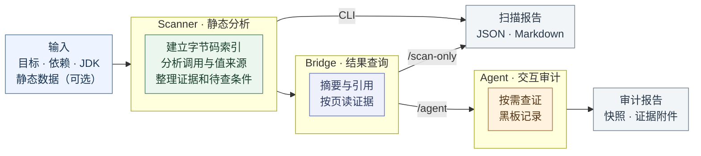

# JustSimple

JustSimple 是一款面向 Java 反序列化风险的本地字节码审计工具。提供应用或组件的编译产物和目标类库，就可以顺着调用关系和数据来源排查风险，查看依据及成立条件。

## 工作流程

## 项目特点

- **扫描可以独立运行。** Scanner 支持离线扫描和报告导出。想继续查证时，可在 Agent 终端使用同一套分析能力。
- **发现可以回查到字节码。** 报告保留相关指令和调用关系，也会说明缺少哪些条件、分析查到了哪里。
- **证据按需读取。** 终端先展示摘要，需要时再翻到具体指令或关系。

## 文档

[开始使用](docs/usage.md) · [架构](docs/architecture.md) · [交互审计](docs/reference/audit.md) · [Gleipner 评测](docs/evaluation.md)

[开发约束](AGENTS.md) · [第三方依赖许可](docs/THIRD_PARTY_NOTICES.md)
